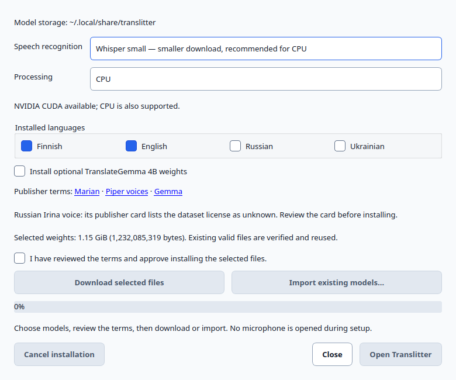
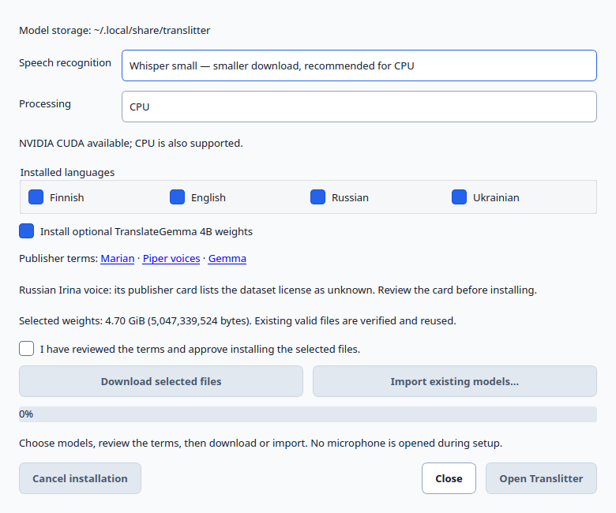
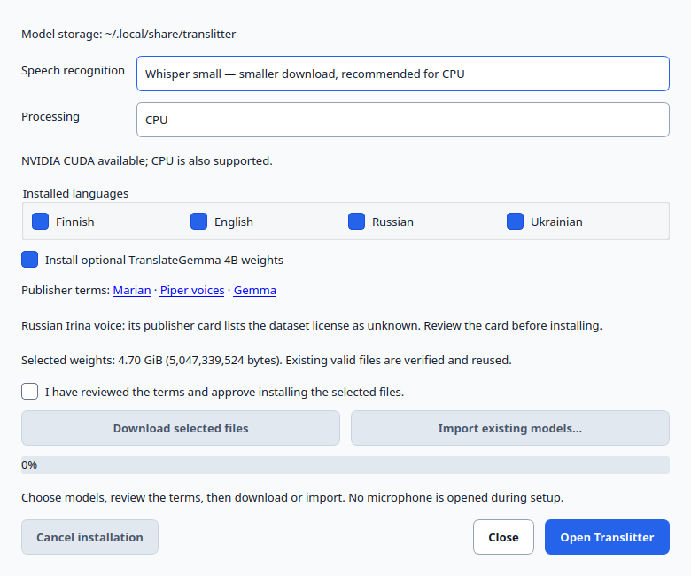
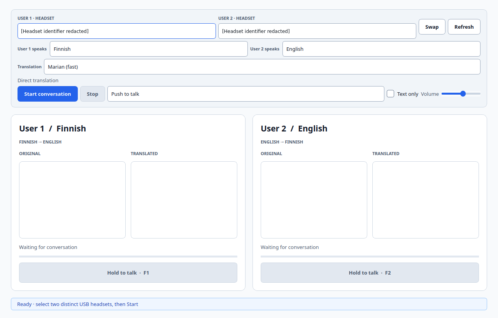

# Install Translitter on Linux — AppImage and model weights

This guide is for **`Translitter-0.2.0-preview.1-x86_64.AppImage`**, the
GPU-capable preview prepared and exercised on **Ubuntu 24.04.5, x86_64, glibc
2.39, X11/XWayland (`xcb`)**. Other distributions, older glibc and native
Wayland-only desktops are not certified. Read the [requirements](../requirements.md)
before allocating disk space or buying hardware.

The [verification record](#artifact-verification-record) lists the local checks
and release gates for this preview. Obtain files only from an actual authorized
release; a source checkout or a passing test does not establish asset availability.

## Contents

1. [Download, verify and launch](#1-download-verify-and-launch)
2. [Choose and install models](#2-choose-and-install-models)
3. [Offline import and exact directory layout](#3-offline-import-and-exact-directory-layout)
4. [Connect headsets and start a conversation](#4-connect-headsets-and-start-a-conversation)
5. [Command-line checks without recording](#5-command-line-checks-without-recording)
6. [Storage and manual updates](#6-storage-and-manual-updates)
7. [Troubleshooting](#7-troubleshooting)
8. [Model terms and permissions](#model-terms-and-permissions)
9. [Artifact verification record](#artifact-verification-record)

## 1. Download, verify and launch

### Obtain the authorized release assets

1. Sign in to a GitHub account authorized to read **`JJkissa/translitter`**.
   The repository is **private**; do not change its visibility to work around
   access trouble. GitHub requires repository read access to view releases.[10]
2. Open that repository's **Releases** page and find the maintainer-verified
   `0.2.0-preview.1` release once publication is confirmed. If it is not there,
   ask the maintainer; publication may still be pending. If GitHub returns 404,
   also check which account is signed in and whether access was granted.
3. Download both assets into the same folder:
   - `Translitter-0.2.0-preview.1-x86_64.AppImage`
   - `SHA256SUMS`
4. Keep the filenames intact. Avoid third-party repackaged copies.

The locally verified candidate is **1,743,821,304 bytes** (approximately
**1.624 GiB**), excluding separately installed models. Its SHA-256 is:

```text
1346d1978e589a38b3c0e385992cda0d4ba261a4799848807ed5c6358917910a
```

This candidate identity must match the final published asset and manifest. If
it changes, the maintainer must update the verification record; do not ignore a
mismatch because the version name is the same.

### Verify SHA-256, then run as your normal user

Open a terminal in the download folder. For a default browser download location:

```bash
cd "$HOME/Downloads"
sha256sum --check SHA256SUMS
```

Confirm the AppImage's line says **`OK`**. If the manifest lists additional
assets you did not download, those lines may report missing files; that does
not waive the requirement for the exact AppImage's own line to pass. You can
also print its digest and compare it with the manifest and candidate digest:

```bash
sha256sum Translitter-0.2.0-preview.1-x86_64.AppImage
```

A matching downloaded checksum is an integrity check, not an independent
publisher signature. Obtain the manifest through the authorized release too.
Do not launch a mismatched or incomplete download.

```bash
chmod +x Translitter-0.2.0-preview.1-x86_64.AppImage
./Translitter-0.2.0-preview.1-x86_64.AppImage
```

**Do not use `sudo`. No Python, venv, LM Studio, Ollama, Docker, pip install or
source checkout is required on the user's PC.** First launch opens native model
setup if settings or selected resources are missing. Models and settings are
written to your own data directory, not to the mounted AppImage.

### If FUSE mounting is unavailable

The pinned AppImage type-2 runtime is statically linked: it does **not** require
installing `libfuse2` on the target system.[33] Mounting still needs a working
host FUSE device/helper and appropriate access. Do not install the obsolete
`fuse` package or replace the desktop's FUSE 3 setup just to try this application.

Use the runtime's extraction fallback instead; AppImage documents these
mechanisms.[2]

**One-shot extraction and launch:**

```bash
APPIMAGE_EXTRACT_AND_RUN=1 ./Translitter-0.2.0-preview.1-x86_64.AppImage
```

This extracts temporary runtime files before launch and cleans them afterward;
allow extra free space and startup time.[2]

**Persistent manual extraction:** choose a new empty folder so an old extraction
cannot contaminate the new one. From the folder containing the downloaded image:

```bash
mkdir Translitter-extracted-0.2.0-preview.1
cd Translitter-extracted-0.2.0-preview.1
../Translitter-0.2.0-preview.1-x86_64.AppImage --appimage-extract
./squashfs-root/AppRun
```

Arguments go after `AppRun`, for example `./squashfs-root/AppRun --setup`.
Extracting does not install models or authorize downloads. Use the same data
directory as the normal AppImage. Both extraction approaches and normal FUSE
launch have been exercised on the stated Ubuntu host, not every Linux system.

## 2. Choose and install models

### Start with Small / CPU / Finnish–English



*Actual native first-run window from the built AppImage. Setup does not open
microphones or play audio.*

1. Leave **Speech recognition → Whisper small — smaller download, recommended
   for CPU** selected for the first trial.
2. Leave **Processing → CPU** selected. If a compatible NVIDIA GPU/host driver
   and bundled library probe succeed, **NVIDIA CUDA** is also offered. Start
   with CPU when diagnosing a new installation.
3. **Finnish** and **English** are selected and required. Baseline translators
   and voices are installed even if you plan to speak Russian/Ukrainian or use
   TranslateGemma, because the engine initializes the FI/EN baseline.
4. Optionally select **Russian** and/or **Ukrainian**. Each adds two Marian
   translators and a target voice. Setup only installs resources; choose the
   participants' actual spoken languages in the main window later.
5. Optionally select **Install optional TranslateGemma 4B weights**. This is a
   separate large download, with separate Gemma terms. It uses the AppImage's
   bundled local runtime; it does not require LM Studio.
6. Read the [model/voice terms](#model-terms-and-permissions), including the
   Irina unknown-dataset-license warning and Lessac dataset agreement. Check
   **I have reviewed the terms and approve installing the selected files.**
7. Click **Download selected files** to explicitly authorize HTTPS transfer,
   or use [offline import](#3-offline-import-and-exact-directory-layout).



*Review the selected-weight total and terms before choosing Download or Import.
This is a selection example, not evidence that every illustrated option was
installed by a network download.*

There are no hidden runtime model downloads. Publisher links open a browser
and may use the network. Once files are installed, conversation inference is
local. Download setup needs internet; local import and subsequent conversation
do not.

### Progress, verification, cancellation and reopening

- The progress bar and status show the current relative file and cumulative
  bytes for the selected set. The **Selected weights** total is the entire
  selected installed set, **not** a promise that all those bytes must be
  downloaded again. Already-valid files are hashed and reused.
- Each new/imported file must match its pinned byte length and **SHA-256**
  before it replaces the final path. A folder merely having the right name is
  not sufficient for verified installation.
- **Cancel installation** requests cancellation. Wait for it to finish; an
  active socket read can take time to return. Completed verified files remain.
  Network `.part` prefixes can resume on retry if the server provides the
  exact expected HTTP range. Local imports restart the interrupted file.
- Closing during installation first cancels and waits; do not force-delete
  partial files while the application is running.
- After a successful install, settings are saved and **Open Translitter** is
  enabled. If changing only setup options around existing valid files, reopen
  setup and use Download/Import to verify any newly selected resources.



*Actual reopened configured setup. Its inactive 0% progress bar is not an
active-download completion display; the enabled **Open Translitter** button
shows that the saved selected set is present. Re-run explicit installation to
perform checksum verification again if integrity is in doubt.*

Click **Open Translitter** and wait for models to become ready. **Checking the
optional-quality install box does not select the quality translator.** The main
window still defaults to **Marian (fast)**; explicitly choose **TranslateGemma
4B** there while stopped if you want it.

To change speech recognition model/device, add languages or install quality
weights later, close the main application and reopen setup:

```bash
./Translitter-0.2.0-preview.1-x86_64.AppImage --setup
```

These ASR/device controls are in the setup window, not a hidden main-window
settings page. Setup reuses saved selections. Turbo is larger; it is not needed
for the CPU baseline. The CPU/CUDA choice controls Whisper recognition.
TranslateGemma independently probes the bundled Vulkan backend and otherwise
uses its bundled CPU backend, so **CPU is not a global no-GPU switch**.

### Exact model sizes

The following totals were calculated in Python from the pinned catalogs using
`load_catalog()` and `required_assets()`, including metadata/cards/configs.
**FI/EN is always included.** `+ RU` and `+ UK` add to that baseline. Values are
installed file totals, not RAM/VRAM use or compressed download estimates.
`1 GiB = 1,073,741,824 bytes`.

| Speech model | Languages | Marian set: bytes | GiB | Same set + TranslateGemma: bytes | GiB |
|---|---|---:|---:|---:|---:|
| Small | FI/EN | 1,232,085,319 | 1.147 | 3,722,003,062 | 3.466 |
| Small | FI/EN + RU | 1,918,252,565 | 1.787 | 4,408,170,308 | 4.105 |
| Small | FI/EN + UK | 1,871,254,535 | 1.743 | 4,361,172,278 | 4.062 |
| Small | FI/EN + RU + UK | 2,557,421,781 | 2.382 | 5,047,339,524 | 4.701 |
| Turbo | FI/EN | 2,367,538,377 | 2.205 | 4,857,456,120 | 4.524 |
| Turbo | FI/EN + RU | 3,053,705,623 | 2.844 | 5,543,623,366 | 5.163 |
| Turbo | FI/EN + UK | 3,006,707,593 | 2.800 | 5,496,625,336 | 5.119 |
| Turbo | FI/EN + RU + UK | 3,692,874,839 | 3.439 | 6,182,792,582 | 5.758 |

Individual pinned groups, useful when preparing an offline drive:

| Directory under `models/` | Bytes, including pinned supporting files |
|---|---:|
| `whisper-small` | 486,214,370 |
| `whisper-turbo` | 1,621,667,428 |
| `translate-en-fi` | 315,327,766 |
| `translate-fi-en` | 304,130,182 |
| `voice-fi` | 63,206,471 |
| `voice-en` | 63,206,530 |
| `translate-en-ru` | 311,479,440 |
| `translate-ru-en` | 311,481,476 |
| `voice-ru` | 63,206,330 |
| `translate-en-uk` | 309,267,975 |
| `translate-uk-en` | 309,267,975 |
| `voice-uk` | 20,633,266 |
| `quality-translategemma-4b` (compatible GGUF + license only) | 2,489,917,743 |

Keeping **both** speech models and all four language resources takes
**4,179,089,209 bytes (3.892 GiB)** without quality weights, or
**6,669,006,952 bytes (6.211 GiB)** with them. Setup does not delete old or
unselected model files when you switch models. Allow additional space for the
1.624 GiB AppImage, partial/replacement files, extraction, filesystem overhead
and a retained previous application version. See the conservative planning
allowances in [requirements.md](../requirements.md#cpu-ram-and-disk-planning).

## 3. Offline import and exact directory layout

Prepare the selected **pinned** files on a connected machine and transfer the
folder intact. You may reuse an older Translitter model tree containing the
matching Hugging Face files. Import copies selected assets; it does not move,
delete or rewrite the source tree. Budget space for both the source and the
installed copy if they share a disk.

1. Run `--setup`, choose the same resources as are available on the offline drive,
   review the terms and approve installation.
2. Click **Import existing models…**.
3. In the chooser, select the **parent folder containing `models/`**, such as
   `/media/your-user/Transfer/Translitter-assets`, **not** its `models/` child.
4. Wait for checksums, then click **Open Translitter** when enabled. Missing or
   mismatched selected assets fail visibly; import does not fetch replacements.

Keep these relative folders and filenames exactly; directory names are
case-sensitive. Optional directories are needed only for the corresponding
selection, but the FI/EN baseline is always needed.

```text
Translitter-assets/                         ← select this parent folder
└── models/
    ├── whisper-small/
    │   ├── README.md
    │   ├── config.json
    │   ├── model.bin
    │   ├── tokenizer.json
    │   └── vocabulary.txt
    ├── whisper-turbo/                      ← if selected instead of Small
    │   ├── README.md
    │   ├── config.json
    │   ├── model.bin
    │   ├── preprocessor_config.json
    │   ├── tokenizer.json
    │   └── vocabulary.json
    ├── translate-en-fi/                    ← keep the whole pinned group
    ├── translate-fi-en/
    ├── translate-en-ru/                    ← if Russian selected
    ├── translate-ru-en/
    ├── translate-en-uk/                    ← if Ukrainian selected
    ├── translate-uk-en/
    ├── voice-fi/fi/fi_FI/harri/medium/
    │   ├── MODEL_CARD
    │   ├── fi_FI-harri-medium.onnx
    │   └── fi_FI-harri-medium.onnx.json
    ├── voice-en/en/en_US/lessac/medium/
    │   ├── MODEL_CARD
    │   ├── en_US-lessac-medium.onnx
    │   └── en_US-lessac-medium.onnx.json
    ├── voice-ru/ru/ru_RU/irina/medium/
    │   ├── MODEL_CARD
    │   ├── ru_RU-irina-medium.onnx
    │   └── ru_RU-irina-medium.onnx.json
    ├── voice-uk/uk/uk_UA/lada/x_low/
    │   ├── MODEL_CARD
    │   ├── uk_UA-lada-x_low.onnx
    │   └── uk_UA-lada-x_low.onnx.json
    └── quality-translategemma-4b/           ← only for optional quality model
        ├── LICENSE.txt
        └── translategemma-4b-llamacpp-Q4_K_M.gguf
```

Every Marian group contains these **eight** pinned filenames:
`README.md`, `config.json`, `generation_config.json`, `pytorch_model.bin`,
`source.spm`, `target.spm`, `tokenizer_config.json`, `vocab.json`.
`translate-fi-en` additionally contains **`metadata.json`**, for nine files.
Keep the ONNX `.json` sidecar **alongside** its ONNX file; do not flatten the
voice folder hierarchy. The layout above is taken from `VOICE_FILES` in
`translitter/languages.py` and the model lock, not a generic Piper example.

### The quality GGUF is specifically pinned

The supported runtime file is **not** the original incompatible Ollama GGUF.
The installer selects the compatible SandLogic quantization and names it:

```text
models/quality-translategemma-4b/translategemma-4b-llamacpp-Q4_K_M.gguf
bytes: 2489909312
sha256: 526747309109c016db547c6fc1c7b0c9c286b5e7a7556827b5419fd9543a09cd
```

The upstream file is named `translategemma-4b_Q4_K_M.gguf` in
`SandLogicTechnologies/translategemma-4b-it-GGUF`, pinned to commit
`cd39c30302f20fb8b788234d86a0a35a0d050619` in `quality-model.lock.json`.
The publisher provides a GGUF conversion, subject to Gemma terms.[30]
For manual offline preparation, copy that exact verified file under the runtime
name above and include the exact pinned `LICENSE.txt` (**8,431 bytes**).
Do not put a random GGUF, the archived `translategemma-4b-Q4_K_M.gguf`, or an
Ollama store blob into the directory and expect import to accept it. The lock
retains historical Ollama records, but `load_catalog()` installs only the
compatible runtime file and license.

## 4. Connect headsets and start a conversation



*Actual native AppImage window, with the two headset identifiers redacted.
All other pixels are unchanged. Device discovery and Ready/Start-enabled state
were observed; capture, playback and human conversation were not tested.*

1. Connect **two distinct USB headsets**, each with a microphone and headphone
   output. Enable an input/output (duplex) profile in the desktop sound settings
   if required. Default devices, laptop speakers and a single shared headset
   are not substitutes for the two explicit pairs.
2. Wait for **Ready**. Under **User 1** and **User 2**, assign different headset
   entries. USB suffixes distinguish identical models; tooltips show full IDs.
   Use **Refresh** if a newly connected pair is missing. Stop before **Swap**
   or changing assignments.
3. While stopped, choose each user's **spoken language**. They must be different.
   The other user's language becomes that turn's translation/output language.
   Marian uses an English intermediate step for pairs without English; this can
   compound errors. TranslateGemma translates directly between selected languages.
4. Choose **Translation → Marian (fast)** for the baseline, or explicitly choose
   **TranslateGemma 4B** after installing its weights. Wait for translator
   readiness. A missing/failing backend blocks start rather than silently
   switching to a different translator.
5. Leave **Text only** unchecked for spoken output. Choose **Push to talk**;
   optional **Automatic** mode submits on pauses and is a different contract.
6. Lower the system/headset volume, then click **Start conversation**. This is
   the step that opens the selected capture/output devices; setup and the safe
   CLI self-test do not.
7. User 1 holds **F1** or the left **Hold to talk** button and speaks. Pauses are
   allowed while held. **Release before ASR, translation or TTS for that turn
   starts.** The complete accepted turn is then processed and spoken through
   **User 2's** selected headphones.
8. User 2 uses **F2** or the right button; their translation goes to **User 1's**
   headphones. Take alternating turns. Keep the app focused while holding keys.
9. Keep each complete turn **at most 30 seconds, including pauses**. Going over
   the limit discards the **whole** held recording with a warning. It never
   auto-submits a prefix at the cap. Release and repeat a shorter turn.
10. Click **Stop** to close capture, reset playback and invalidate queued/in-flight
    results. Stop before changing languages, translator, mode or headsets.

Switching focus away during held PTT cancels that unsubmitted input; a late
release does not submit it. Previously accepted turns are separate. Incoming
translated playback can wait while the listener is holding their own PTT; queues
are bounded. Speaking can interrupt that participant's playback. These guards
are **not acoustic echo cancellation**; use closed headphones and avoid overlap.
The keys are window-focused controls, not promised system-wide hotkeys.

No conversation log or human audio recording is automatically saved. Check names,
numbers and critical meaning with the other speaker. Human accuracy and physical
headset acceptance remain unestablished for this preview; Marian EN→RU is known
to omit **“today”** in “Hello, how are you today?”. TranslateGemma also changed a
packaged RU→FI greeting's meaning from “how are you?” to “how can I help?”.
Do not rely on the tool for safety-critical interpretation.

## 5. Command-line checks without recording

Run these from the folder containing the AppImage, without sudo. The flags below
are implemented by `translitter/packaged.py`; source-launcher examples in older
documents are not prerequisites.

### Diagnostics — no model inference, capture or playback

```bash
./Translitter-0.2.0-preview.1-x86_64.AppImage --diagnose
```

Reports bundled runtime identity, architecture/libc, data path, CUDA availability
and selected assets. `models_present` is a **path/size presence check**, not a
fresh hash audit. Diagnostics include local paths; review before sharing.
Use explicit installation/import to perform pinned SHA-256 verification.

### Explicit CLI installation

Review terms first. Choose **exactly one** of `--download` or `--from-root DIR`.
FI/EN is always installed even if other codes are selected. The command saves
setup settings after successful verification.

Small/CPU baseline download:

```bash
./Translitter-0.2.0-preview.1-x86_64.AppImage --install-models \
  --download --accept-model-licenses --languages fi,en \
  --model whisper-small --device cpu
```

All four languages and optional quality weights from a local prepared tree:

```bash
./Translitter-0.2.0-preview.1-x86_64.AppImage --install-models \
  --from-root "/media/your-user/Transfer/Translitter-assets" \
  --accept-model-licenses --languages fi,en,ru,uk \
  --model whisper-small --device cpu --quality
```

Replace the example source folder with your real folder **containing `models/`**.
For a larger NVIDIA trial, installation also accepts `--model whisper-turbo
--device cuda`; verify actual GPU readiness separately. Do not blindly add
`--accept-model-licenses` without reviewing the selected publishers' conditions.
Saved optional-quality selections may remain selected from an earlier setup;
`--setup` is the clear way to review/uncheck them.

### Real-model synthetic self-test — still no microphone or playback

After installing the baseline:

```bash
./Translitter-0.2.0-preview.1-x86_64.AppImage --self-test \
  --source fi --target en --model whisper-small --device cpu
```

Optional quality translator, after its weights are installed:

```bash
./Translitter-0.2.0-preview.1-x86_64.AppImage --self-test \
  --source fi --target en --translator translategemma --device cpu
```

For the selected speech model on a working NVIDIA CUDA configuration, replace
`--device cpu` with `--device cuda`. The JSON report includes the selected
model/device/translator, transcript, translation, output sample count/rate and
elapsed time. It generates speech **in memory**, runs ASR → translation → TTS,
and reports `microphones_opened: false`, `audio_played: false` and
`accuracy_certified: false`. It does not record you, play sound, certify human
speech accuracy or establish physical headset routing. A nonzero exit status
means the check failed; inspect its error before relying on the installation.

### Explicit startup/setup screenshots

```bash
./Translitter-0.2.0-preview.1-x86_64.AppImage --setup --screenshot setup.png
./Translitter-0.2.0-preview.1-x86_64.AppImage --screenshot main-window.png
```

These save a requested PNG and close the startup/setup window. The second command
shows setup instead if resources/settings are missing; it is not a way to bypass
setup or capture a live conversation. Use a real graphical desktop. This guide's
four images were captured separately from the actual built AppImage.

## 6. Storage and manual updates

Default application data stays outside the AppImage:

```text
~/.local/share/translitter/
├── settings.json
└── models/
    ├── whisper-small/
    ├── translate-en-fi/
    └── ...
```

An absolute `XDG_DATA_HOME` changes the base to `$XDG_DATA_HOME/translitter`.
`--data-dir DIR` overrides the **whole** application data directory, not just
`models/`. For example:

```bash
./Translitter-0.2.0-preview.1-x86_64.AppImage \
  --data-dir "$HOME/Translitter-data" --setup
```

Keep that flag consistent on future launches and checks, or they will use the
default data root again. The folder must be private/user-owned, not a symlinked
or group/world-writable model destination. `settings.json` contains setup options,
not a transcript. Do not edit it while the app is running.

**Automatic updates are not implemented.** For a manual update:

1. Stop and close Translitter; back up `settings.json` and any irreplaceable data.
2. Download the new authorized AppImage and checksum manifest; verify them.
3. Keep the **old AppImage** until the new one launches and passes diagnostics,
   the no-audio self-test and your own authorized acceptance checks.
4. Launch the new file with the **same data directory**. Existing settings and
   compatible models remain outside either executable. A future model-lock
   change may need another explicit install/import; do not delete the whole
   model tree to update the application.
5. If the update fails, close it and reopen the retained old executable. Restore
   backed-up settings if a future version changed their format; backwards data
   compatibility is not promised indefinitely.

For removal, first stop/close the app. Removing the AppImage does not remove its
separate settings/models. Delete user data only deliberately after checking for
needed files. No automatic conversation log is stored there. OS swap/crash dumps,
manual screenshots and other applications are outside that privacy claim.

## 7. Troubleshooting

| Symptom | Check / safe action |
|---|---|
| Release missing / GitHub 404 | Publication may still be pending. Sign in to the authorized account and confirm private repository read access; do not make the repository public. |
| Checksum mismatch | Do not run the image. Re-download the exact release assets; confirm filenames/version and compare the manifest with the maintainer's recorded candidate. |
| Permission denied when launching | Set the executable bit with `chmod +x`. A filesystem mounted `noexec` can still block launch; move the verified image to a user-owned executable location. Do not use sudo. |
| FUSE/mount error | Use `APPIMAGE_EXTRACT_AND_RUN=1`, or manual extraction and `AppRun`. This runtime does not require libfuse2.[33] Do not replace FUSE 3 with an obsolete package; host mount-policy trouble is separate from model setup. |
| `GLIBC_... not found` / wrong executable format | Check the stated x86_64 / glibc 2.39 target. Other/older platforms are not certified. Extraction does not supply a newer host glibc. |
| Window cannot connect to display / Qt platform error | Launch in the signed-in graphical X11/XWayland session, not a headless shell. Try `QT_QPA_PLATFORM=xcb ./Translitter-0.2.0-preview.1-x86_64.AppImage` only where X11/XWayland is available. Do not borrow the source venv to conceal a broken bundle. |
| No / one headset pair | Check physical USB connections, desktop duplex profiles, privacy permissions and working host audio. Stop and click Refresh. Each headset needs a uniquely matched microphone **and** headphone output; ambiguous endpoints are not replaced with defaults. |
| Headsets reversed | Stop, confirm USB suffix/tooltips and use Swap/reassign. Restart only after both distinct pairs are correct. |
| No spoken output | Check Text only is unchecked, correct recipient pair, headset/system mute and moderate volume. Release the recipient's held PTT so deferred output can play. Setup/self-test intentionally never plays sound. |
| Held turn cancelled | Keep the window focused. Focus loss cancels unsubmitted held input. Release and begin again; the cancelled turn is not silently sent later. |
| Turn too long | All pauses count toward 30 seconds. Overflow discards the whole recording; release and repeat a shorter turn. There is no partial-prefix recovery. |
| CPU too slow | Use Small + Marian, close competing apps, try shorter turns and wait for model readiness. Optional GPU acceleration needs a working host driver; no real-time CPU guarantee is made. |
| CUDA unavailable or GPU memory error | Run `--diagnose`, use `--setup` to select CPU/Small, and investigate host NVIDIA driver/GPU compatibility separately. Bundled CUDA libraries do not install a host driver.[31][22] The probe alone is not a memory-capacity test. |
| TranslateGemma still not used | The setup checkbox only installs it. While stopped, select Translation → TranslateGemma 4B in the main window and wait for readiness. Check compatible GGUF/runtime presence, RAM and optional Vulkan driver. |
| Download/network failure | Retry setup with the same selections. Completed files are verified/reused; network partials resume only with the exact expected range response. The installer does not use ambient proxy settings/credentials; use an appropriate direct HTTPS connection or offline import. |
| Disk full | Stop/close the app and free space outside required model files. Allow partial/replacement, extraction and old-version overhead. Re-run explicit setup after space is available. |
| Settings could not be saved | Setup stays open and shows the failure. Check free space and data-folder ownership/permissions, then click Open Translitter again. Existing settings remain unchanged after a failed save. |
| Import size/hash mismatch | Select the parent containing models/, preserve the nested paths, and use the exact pinned files rather than a different revision or random GGUF. Correct the transfer and retry. |
| Start disabled | Wait for model/translator readiness, choose distinct languages and two distinct valid headset pairs, and check missing-resource/status messages. It is a safety gate, not a request to enable default audio. |

### Failed resume / partial-file cleanup

First retry normally. If the installer reports **Resume Content-Range mismatch**,
**Download length or encoding mismatch**, or an oversized partial, the server or
network path may not satisfy strict resume requirements. **Close every Translitter
process and wait for cancellation to finish before touching partial files.**

Only if a fresh retry is needed, remove **the specifically named incomplete
`.part` file** reported for the failing asset, then retry setup. For example,
**only when that is the failing partial at your active data root**:

```bash
rm -- "$HOME/.local/share/translitter/models/whisper-small/model.bin.part"
```

Adjust the root for `XDG_DATA_HOME`/`--data-dir`. Do not use `rm -rf`, wildcard
model deletion, or remove completed `.bin`, `.onnx`, `.gguf` or settings files as
a generic repair. Removing a partial discards only that file's resume progress.
If a full verified download still fails, report the exact error and use the
pinned offline-import path rather than bypassing hashes.

## Model terms and permissions

Software licensing, model-weight terms and training-dataset permissions are
separate. Review the publisher sources and installed cards before approving
installation; hash verification does **not** establish redistribution permission.
This is an attribution/terms inventory, not a legal clearance opinion.

| Resource | Publisher-reported terms / issue to review |
|---|---|
| Whisper Small conversion | Pinned publisher README declares **MIT**.[23] |
| Whisper Turbo conversion | Publisher README at the pinned revision declares **MIT**. The older locked `mobiuslabsgmbh` URL currently redirects to the publisher's `dropbox-dash` repository; keep the pinned revision and hashes.[32] |
| Marian EN→FI, FI→EN | Publisher cards declare **Apache 2.0**.[24][27] |
| Marian EN→RU | Publisher card declares **Apache 2.0**.[25] |
| Marian RU→EN | Publisher card declares **CC BY 4.0**, not Apache 2.0. Preserve attribution and review the card.[28] |
| Marian EN→UK, UK→EN | Publisher cards declare **Apache 2.0**.[26][29] |
| Finnish Harri | Piper card's **dataset** field says **CC0**; the card also says it was fine-tuned from Lessac. A dataset field is not blanket clearance of every derivative/right.[12] |
| English Lessac | Card links the Blizzard 2013 dataset license.[13] The linked agreement limits its defined materials to research purposes and excludes commercial purposes; clarify applicability/permissions for the intended trained-voice deployment rather than assuming unrestricted use.[20] |
| Russian Irina | Piper card's **dataset license is `Unknown`**; it also records fine-tuning from Lessac. This unresolved field must remain visible; do not advertise the voice as freely redistributable.[14] |
| Ukrainian Lada | Piper card's **dataset** field says **Apache 2.0**; review the accompanying card and upstream dataset context.[15] |
| Optional TranslateGemma 4B GGUF | The conversion publisher labels it **Gemma**, not MIT/Apache.[30] Read Google's Gemma Terms, including use/redistribution conditions, and the pinned installed LICENSE.txt.[4] |

The AppImage carries software notices at `usr/share/doc/translitter/NOTICE` and
`third-party.json` inside its extracted layout; package/native copyright files
and llama.cpp runtime licenses accompany it. This is not a claim that all bundled
software shares one license, or that downloaded model terms are replaced by the
application's license. Model weights are installed separately after consent.

## Artifact verification record

Recorded **October 19, 2026**. This table distinguishes the actual compressed
AppImage from source/AppDir tests. Pending rows must be filled by the maintainer
from actual results, not inferred from a successful build or a screenshot.

| Gate | Actual result / remaining boundary |
|---|---|
| Candidate filename | `Translitter-0.2.0-preview.1-x86_64.AppImage` |
| Candidate bytes | **1,743,821,304**; GPU-capable bundle, no artifact rename required. |
| Candidate SHA-256 | `1346d1978e589a38b3c0e385992cda0d4ba261a4799848807ed5c6358917910a` |
| Normal FUSE launch | **Passed** on Ubuntu 24.04.5 / glibc 2.39 / x86_64. |
| Manual extraction + AppRun | **Passed** on the same host. |
| `APPIMAGE_EXTRACT_AND_RUN=1` | **Passed** on the same host. |
| Relocation, directory/filename containing spaces | **Passed**. |
| Clean HOME/PATH without source venv or LM Studio | **Passed**; does not establish a different distribution's compatibility. |
| Explicit CLI checksum import | **Passed**, 12 pinned asset groups; source tree was not needed for runtime inference. |
| Native setup / main-window readiness | **Passed**; four genuine AppImage images above were captured and visually checked for clipping. Main window reached Ready and Start enabled with two USB headset pairs detected. |
| Small/CPU FI→EN synthetic full pipeline | **Passed**; “Hei, miten voit tänään?” → “Hey, how are you today?”. Generated in memory; no microphone or playback. |
| Broader AppImage language/backend matrix | **Passed 14 functional generated-speech cases:** all 12 Marian FI/EN/RU/UK directions, including EN→FI with CUDA ASR; TranslateGemma RU→FI with CUDA ASR and FI→EN with CPU ASR. No capture/playback; meaning is not certified. No new owned model-server processes remained. |
| Real HTTPS pinned asset through AppImage | **Passed:** bundled Python/certificates downloaded a missing 2,370-byte pinned Whisper Small configuration, checked its SHA-256 and reused the other verified installed files. |
| Current source full opt-in model suite | **2,119 passed, 2 physical-hardware skips, 1 known quality expected failure in 125.93 seconds.** This source suite is separate from the actual-AppImage checks above. |
| Physical capture / playback / human conversation | **Not performed** for this artifact; discovery and enabled Start are not physical audio acceptance. |
| Cross-distribution / native-Wayland / minimum RAM / latency | **Not established**. |
| Independent final review | **Passed** for the frozen local preview candidate; publication/readback and the acceptance boundaries below remain separate. |
| Private release download availability | Check the private repository's Releases page for the named version and matching asset/checksum. Availability requires authorized repository access; this guide does not attest upload status. |

Known accuracy limitations, including Marian's EN→RU “today” omission, remain
even when an execution matrix passes. Generated-speech fixtures cannot certify
human recognition, acoustic conditions, translation fidelity or headsets.

### Evidence and source scope

Product controls, CLI flags, storage paths and byte totals were read from
`translitter/packaged.py`, `setup_ui.py`, `model_setup.py`, `package_paths.py`,
`package_runtime.py`, `languages.py`, `ui.py`, `core.py`, the model locks and
`packaging/build_appimage.py` / `tools.lock.json`. The artifact observations above
are the maintainer's actual built-image checks. External technical/model/terms
facts below were checked against the primary publishers on **October 19, 2026**.

## Sources

[2] https://docs.appimage.org/user-guide/troubleshooting/fuse.html
[4] https://ai.google.dev/gemma/terms
[10] https://docs.github.com/en/repositories/releasing-projects-on-github/about-releases
[12] https://huggingface.co/rhasspy/piper-voices/raw/c10ece1aade47bb51c153c893d14e5bf8e5b7117/fi/fi_FI/harri/medium/MODEL_CARD
[13] https://huggingface.co/rhasspy/piper-voices/raw/c10ece1aade47bb51c153c893d14e5bf8e5b7117/en/en_US/lessac/medium/MODEL_CARD
[14] https://huggingface.co/rhasspy/piper-voices/raw/c10ece1aade47bb51c153c893d14e5bf8e5b7117/ru/ru_RU/irina/medium/MODEL_CARD
[15] https://huggingface.co/rhasspy/piper-voices/raw/c10ece1aade47bb51c153c893d14e5bf8e5b7117/uk/uk_UA/lada/x_low/MODEL_CARD
[20] https://www.cstr.ed.ac.uk/projects/blizzard/2013/lessac_blizzard2013/license.html
[22] https://docs.nvidia.com/deploy/cuda-compatibility/minor-version-compatibility.html
[23] https://huggingface.co/Systran/faster-whisper-small/raw/536b0662742c02347bc0e980a01041f333bce120/README.md
[24] https://huggingface.co/Helsinki-NLP/opus-mt-en-fi/raw/main/README.md
[25] https://huggingface.co/Helsinki-NLP/opus-mt-en-ru/raw/main/README.md
[26] https://huggingface.co/Helsinki-NLP/opus-mt-en-uk/raw/main/README.md
[27] https://huggingface.co/Helsinki-NLP/opus-mt-fi-en/raw/main/README.md
[28] https://huggingface.co/Helsinki-NLP/opus-mt-ru-en/raw/main/README.md
[29] https://huggingface.co/Helsinki-NLP/opus-mt-uk-en/raw/main/README.md
[30] https://huggingface.co/SandLogicTechnologies/translategemma-4b-it-GGUF/raw/main/README.md
[31] https://raw.githubusercontent.com/SYSTRAN/faster-whisper/master/README.md
[32] https://huggingface.co/dropbox-dash/faster-whisper-large-v3-turbo/raw/0a363e9161cbc7ed1431c9597a8ceaf0c4f78fcf/README.md
[33] https://raw.githubusercontent.com/AppImage/type2-runtime/8f39b89e2ac31e1640b3d3f7e9a5108e6ce805fa/README.md
